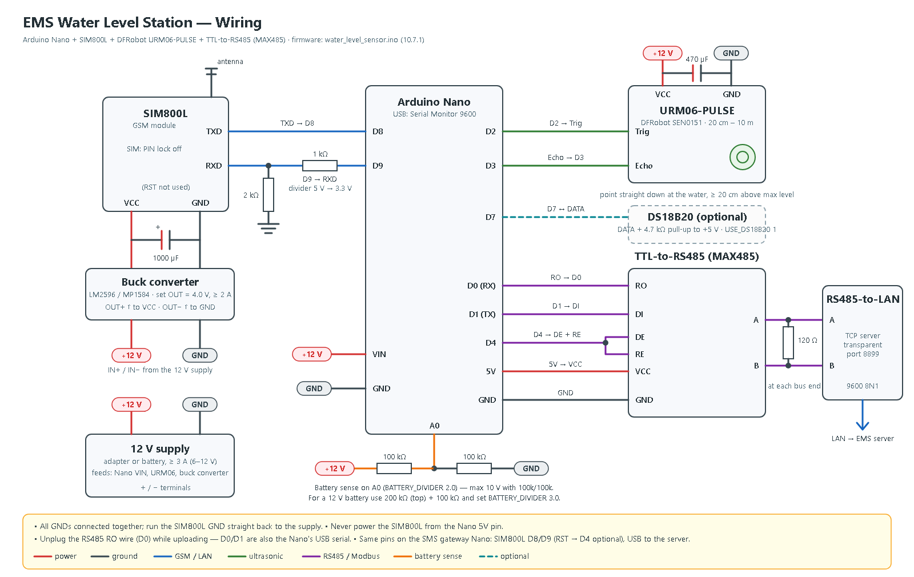

# Water Level GSM Firmware

Two Arduino Nano sketches that let water level sensors report to EMS by SMS, with no internet connection needed at the sensor or the gateway.

```text
Water level station (Nano + SIM800L + URM06-PULSE)
        |  SMS: WL1,<station>,<seq>,<distance_cm>,<battery_mV>,<temp>,<interval>
        v
GSM gateway (Nano + SIM800L)  --USB serial-->  scripts/water_level_gsm.py  -->  IOT_water_level
        ^                                                |
        |  SMS: WLCFG,<minutes>   <--  interval set per station in the dashboard
```

| Sketch | Runs on | Job |
| ------ | ------- | --- |
| `gsm_gateway/gsm_gateway.ino` | Nano + SIM800L, plugged into the EMS server by USB | Passes received SMS to the server; sends the SMS the server asks for. Each SMS stays on the SIM until the server has saved it. |
| `water_level_sensor/water_level_sensor.ino` | Nano + SIM800L + DFRobot URM06-PULSE at each station | Measures distance to the water and texts a reading every interval. Applies interval changes sent from the dashboard and confirms them. |

## Parts (per device)

- Arduino Nano (ATmega328P)
- SIM800L module and a SIM with the PIN lock disabled
- Power for the SIM800L: **3.7–4.2 V, able to deliver 2 A peaks** (an 18650 Li-ion cell, or a buck converter set to 4.0 V) and a 470–1000 µF capacitor across its VCC/GND
- 1 kΩ and 2 kΩ resistors (level shifter for the SIM800L's RX pin)
- Station only: DFRobot **URM06-PULSE** ultrasonic sensor (SEN0151, range 20 cm – 10 m); a **6–12 V supply** for it (e.g. a 2S Li-ion pack or a 12 V battery, which can also feed the Nano's VIN pin); 2 × 100 kΩ resistors for battery monitoring; optional DS18B20 temperature probe with a 4.7 kΩ pull-up

## Wiring



Both devices connect the SIM800L the same way:

| SIM800L | Nano | Notes |
| ------- | ---- | ----- |
| TXD | D8 | |
| RXD | D9 | Through a divider: D9 → 1 kΩ → RXD, and RXD → 2 kΩ → GND |
| RST | D4 (gateway only, optional) | Lets the gateway Nano restart a hung modem. Not used on the stations: their D4 drives the RS485 module, and they restart the modem with `AT+CFUN=1,1` |
| VCC | — | Separate 3.7–4.2 V / 2 A supply, **not** the Nano's 5V or 3V3 pin |
| GND | GND | Common ground with the Nano and the supply |

Sensor only:

| Part | Nano |
| ---- | ---- |
| URM06-PULSE Trig / Echo | D2 / D3 (sensor VCC 6–12 V, GND common with the Nano) |
| TTL-to-RS485 module (MAX485) RO / DI | D0 (RX) / D1 (TX) |
| TTL-to-RS485 DE + RE (tied together) | D4 |
| Battery divider midpoint (battery + → 100 kΩ → A0 → 100 kΩ → GND) | A0 |
| DS18B20 data (optional) | D7 |

Mount the URM06-PULSE pointing straight down at the water, **at least 20 cm above the highest expected water level** (it can't measure closer than 20 cm). Its height above your reference point is the station's **Installation Height** in the dashboard; EMS calculates water level as installation height minus the measured distance.

How the sketch reads it: Trig idles HIGH; a LOW pulse of 60 µs starts one measurement; Echo returns a HIGH pulse of **1 µs per mm**. A 15,000 µs pulse means the sensor couldn't measure. Each reading is the median of 5 measurements. If none succeed, the station sends distance `0`, which EMS stores as "no echo" (no water level) and logs as a Device warning.

### Second path: RS485 → LAN (Modbus)

Besides SMS, each station is a **Modbus RTU slave** on RS485. An **RS485-to-LAN converter** at the station puts it on the network, and the EMS server reads it every minute (`water_level_gsm.py`, `WATER_LAN_POLL_SEC`, default 60). Both paths save into the same readings table: the LAN gives a reading every minute, SMS keeps working when the network is down.

```text
URM06 -> station Nano -+-> SIM800L --SMS--> SMS gateway Nano --USB--> EMS server
                       +-> TTL-to-RS485 -> RS485-to-LAN converter --LAN (Modbus RTU over TCP)--> EMS server
```

- **Converter settings:** TCP server, **transparent mode** (also called "None"/"TCP Server", not Modbus TCP gateway), port **8899**, serial side **9600 8N1**. Give it a fixed IP.
- **Dashboard:** in **Stations › Water Level**, set the station's **RS485-to-LAN Converter IP**, **Port** (8899) and **Modbus Address** (the sketch's `MODBUS_ID`). Leave the IP empty for SMS-only stations. Each station needs its own converter IP.
- **Wiring:** RS485 A/B from the station's TTL-to-RS485 module to the converter's A/B (120 Ω terminator across A/B at long cable runs).
- **Address:** set `MODBUS_ID` in the sketch: 1–247. With one converter per station it can be 1 everywhere, but giving each station its own (WLS001 = 1 … WLS009 = 9) avoids mistakes.
- **Functions:** 03 (read holding registers) and 04 (read input registers) return the same map. It is read-only.

| Register (0-based) | Value | Unit |
| ------------------ | ----- | ---- |
| 0 | Distance to the water | cm (0 = no echo) |
| 1 | Battery | mV |
| 2 | Temperature | 0.1 °C, signed (−32768 = no probe fitted) |
| 3 | Reporting interval | minutes |
| 4 | SMS sequence number (low 16 bits) | — |
| 5 | Age of the measurement | s (65535 = not measured yet) |

The station measures every second and before each SMS. A request that arrives during a measurement is answered right after it (under a second late). While it is sending an SMS (up to about a minute) it doesn't answer; a master that retries after a timeout gets the next reply.

Test from the server with a USB-to-RS485 adapter (`sudo apt install mbpoll`):

```bash
mbpoll -m rtu -a 1 -b 9600 -P none -t 3 -r 1 -c 6 /dev/ttyUSB0
```

`-t 3` reads input registers, and `-r 1` is register 0 (mbpoll counts from 1). **Unplug the RS485 module (or its RO wire) while uploading the sketch**: D0/D1 are also the Nano's USB serial.

**Watching the readings on USB:** with `SERIAL_DEBUG 1` (the default), open the Serial Monitor at **9600** to see a live line every second, for example `Distance: 315 cm  Battery: 3912 mV  Temp: NA`, plus `SMS SENT OK: …` or `SMS FAILED (<reason>): …` for every SMS the station sends (power-on, readings and interval confirmations). This works with the RS485 module connected: the text doesn't reach the RS485 bus. Set `SERIAL_DEBUG 0` to turn it off.

## Setup

1. **Install the Arduino IDE** and select **Tools › Board › Arduino Nano**, **Processor › ATmega328P**. (Many clone Nanos need **ATmega328P (Old Bootloader)** — use that if the upload fails.)
2. **Gateway:** open `gsm_gateway/gsm_gateway.ino` and upload it. Nothing to edit.
3. **Sensor:** open `water_level_sensor/water_level_sensor.ino`, set the four `>>>` settings at the top, and upload (with the RS485 module unplugged):
   - `STATION_MN` — the station's Station MN in the dashboard
   - `GATEWAY_NUMBER` — the gateway SIM's number, e.g. `+639171234567`
   - `DEFAULT_INTERVAL` — interval used until the dashboard sends one
   - `MODBUS_ID` — this station's Modbus address on the RS485 bus (different for each station)
   For the DS18B20 probe, set `USE_DS18B20 1` and install the **OneWire** and **DallasTemperature** libraries first.
4. **Dashboard:** in **Stations › Water Level**, add the station with the sensor's **SIM number** (the IP address can stay empty), **Installation Height**, and **Reporting Interval**.
5. **Server:** plug the gateway Nano into a USB port of the EMS server. In **Stations › Water Level**, scroll to **GSM Gateway (USB)**, click **Scan ports**, then **Connect** on the Nano's port (a CH340 / FTDI chip is marked as the likely gateway). This saves `WATER_GSM_SERIAL_PORT` (the stable `/dev/serial/by-id/...` name) and `WATER_GSM_ENABLED=true` in `scripts/.env` and restarts `ems-water-level-gsm.service`. The panel also warns if **brltty** (takes over CH340 ports on Ubuntu) or **ModemManager** (disturbs the SIM800L) is present.
6. **Check:** `sudo journalctl -u ems-water-level-gsm.service -f` should show `GSM gateway ready`, a signal/registration line every minute, and the interval being sent to the sensor. Right after power-up the sensor texts `WLON,<station>,<interval>` (logged as "<station> powered on"; retried with each reading until it goes through), and sends its first reading one minute later, then one every interval (default **3 min**).

## Testing the SMS link

On **Stations › Water Level**, click the **Test SMS** (speech bubble) button on a station's row. The server texts `WLPING` to the station through the gateway; the station (only from `GATEWAY_NUMBER`) measures and answers `WLPONG,<station>,<interval>,<distance_cm>,<battery_mV>`. The row shows:

- **Replied in N s** with the station's fresh reading — the whole SMS path works both ways
- **Gateway could not send…** — the gateway's SIM800L / SIM / load
- **No reply after 5 min** (SMS sent) — the station's power, signal, SIM or `GATEWAY_NUMBER`
- **Not sent after 5 min** — the gateway isn't connected or `water_level_gsm.py` isn't running

A test that couldn't be sent within 10 minutes is dropped, so an old test isn't texted after an outage.

## Changing the interval

Edit the station in **Stations › Water Level** and change **Reporting Interval**. The Interval column shows:

- **Pending** — waiting to be sent
- **Sent** — texted to the sensor, waiting for its confirmation
- **Applied** — the sensor confirmed it (it replies `WLACK` immediately and reports its interval in every reading)

Unconfirmed settings are re-sent every `WATER_GSM_RESEND_MINUTES` (default 30). The sensor saves the interval, so it survives power loss. It only accepts settings from `GATEWAY_NUMBER`.

On the dashboard, a water level station counts as online when it has reported within its interval plus 2 minutes, and idle until it misses a second interval.

## Cost

Receiving SMS is free, so the gateway SIM only pays for interval changes. Each sensor SIM pays for its readings:

| Interval | SMS per sensor per day |
| -------- | ---------------------- |
| 5 min | 288 |
| 15 min | 96 |
| 30 min | 48 |
| 60 min | 24 |

Use an unlimited-text promo on the sensor SIMs. Keep the gateway and sensor SIMs on the same network if the promo only covers same-network texts.

## Testing without a sensor

Text the gateway SIM from any phone registered as a station's SIM number, for example:

```text
WL1,WLS001,1,150,3900,NA,15
```

It appears in the dashboard within seconds. Every received SMS, including rejected ones (unknown sender, wrong format), is logged in the `gsm_messages` table of `IOT_water_level`.

To watch the gateway directly, stop the service and open the Nano's port in the Arduino Serial Monitor at **57600 baud**, newline line endings. Type `PING` (expect `+PONG`); received SMS appear as `+SMS|...` lines.

## Troubleshooting

- **Modem keeps resetting / `+ERR|modem not responding`:** the power supply can't deliver 2 A peaks. Use a Li-ion cell or a stronger buck converter, add the capacitor, and keep the power wires short.
- **`network NOT registered`:** check the antenna, the SIM (PIN lock off, active, has load), and signal (CSQ below 10 is weak; 2G coverage is required by the SIM800L).
- **Readings logged as "no station has SIM number":** the station's SIM number in the dashboard doesn't match the sender. Numbers are compared in `+63...` form; `09...` is converted automatically.
- **Water level shows "—" but distance is stored:** set the station's Installation Height.
- **"the sensor got no echo" on the Logs page:** check the URM06 wiring (Trig D2, Echo D3), its 6–12 V supply, and that nothing is within 20 cm of the sensor or blocking its beam.
- **The gateway Nano isn't listed under Scan ports:** try another USB cable (some are charge-only) and run `ls /dev/serial/by-id/`. On Ubuntu, remove brltty (`sudo apt remove brltty`), which takes over CH340 ports.
